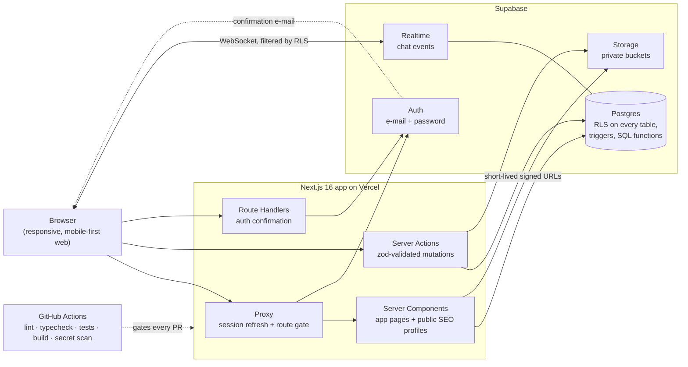
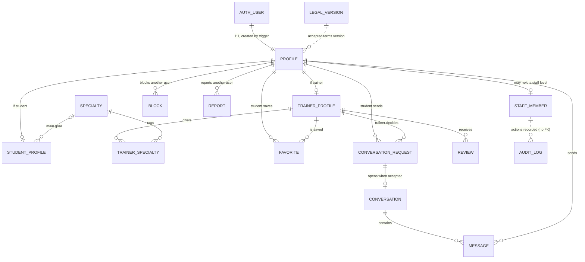

# Gym Match: case study

> **Gym Match** (working name) is a two-sided marketplace that
> connects gym students with personal trainers in Brazil.
> The source code is private. This repository documents the product, the
> architecture and the engineering decisions behind it.

🇧🇷 [Leia em português](README.pt-BR.md) · 🧭 [Architecture deep dive](docs/architecture.md)

---

## 1. Overview

People who want a personal trainer usually find one through word of mouth at
the gym or on Instagram. Neither lets them compare trainers by what actually
drives the decision: specialty, price range, location, where the training
happens (studio, outdoors, at home, online), languages, and the age groups the
trainer works with. Trainers face the opposite problem: finding clients still
depends mostly on prospecting on the gym floor or on social media.

The product has two user types. A **student** (_aluno_) wants a trainer who
fits their goals, budget, location and training style. A **trainer**
(_personal_) wants qualified leads. The role is chosen at signup, and the
database prevents anyone from changing it afterwards.

Students fill in a short profile and then search a **filtered directory** of
trainers with 8 combinable filters. They can bookmark favorites and send a
**conversation request**. The trainer accepts it from an inbox, and a
**realtime chat** opens. Every trainer with a complete profile also gets a
public profile page that search engines can index. Blocking and reporting work
in both directions, and an internal **staff console** covers moderation,
read-only support and auditing.

> **The first product decision was to drop the swipe.** The original concept
> was Tinder-style (swipe → match). On day 2 the core model was changed to a
> filtered directory plus _request → accept_ (two decision records, ADR-004 and
> ADR-005). A blind swipe deck hides the attributes that actually decide the
> choice, such as price, location and specialty. And a request inbox is a lead
> funnel that trainers already understand, so they never have to browse
> students.

## 2. My role

I am the **only developer** on this project, and it is my first complete
product, built end to end. The original product concept came from a
non-technical business partner. My responsibilities:

- **Product scoping:** turned the concept into a scoped v1, wrote the charter,
  and decided what to cut (in-app class payments, scheduling and native apps
  all stay out of v1).
- **Architecture and decisions:** stack, connection model, discovery model and
  web-first strategy, each recorded as an ADR (Architecture Decision Record)
  with context, decision and consequences.
- **Data and security model:** schema, Row Level Security (RLS) policies,
  column-level grants, and the separation between product roles and staff
  levels.
- **Review and verification:** I reviewed every change. I required each one to
  be verified against the real database by calling the API as ordinary test
  users, and I tested features by hand from written test scripts.
- **Operations:** GitHub, CI, Supabase and Vercel configuration, releases and
  tags.

**AI-assisted development, stated openly.** I built this with Claude Code as an
AI pair programmer, and most commits are co-authored by it. The speed came from
there. My job was to keep that speed safe:

- Each session started with a written goal and acceptance criteria.
- A project rules file set the security defaults.
- A pre-commit hook blocks commits until lint, typecheck and tests pass.
- Another hook blocks access to secret files.
- Two dedicated **read-only reviewer agents**, one for security and one for
  code, audited every phase before merge.

I treated AI output as untrusted until it was verified. That is why the
problems in [section 7](#7-hard-problems-and-how-they-were-solved) were caught
before they shipped.

## 3. Architecture

A **modular monolith**: one Next.js application deployed on Vercel, with
Supabase as the entire backend platform. Code is organized by feature (`auth`,
`profiles`, `discovery`, `matching`, `chat`, `admin`, `legal`), and shared
code lives apart from it.



Three facts shape this design:

- **Every query runs as the signed-in user.** The server uses the user's
  session, so Postgres RLS applies to every read and write. The
  `service_role` key, which bypasses RLS, is **not used by the application
  code at all**. Only local tooling uses it (photo seeding and end-to-end
  tests).
- **The browser talks to Supabase directly in one place only:** the chat.
  There it subscribes to new messages and read receipts over Realtime, and
  re-syncs anything it missed after a reconnect. Both paths are filtered by
  RLS.
- **Some components do not exist yet, and the diagram leaves them out on
  purpose.** There is no native mobile app (decided: web first), no payment
  processing, no maps or geolocation (city and state are
  structured text fields), no external e-mail provider and no error tracking.
  Google sign-in is implemented but disabled behind a feature flag.

Sequence diagrams for the main flows are in
[docs/architecture.md](docs/architecture.md).

## 4. Tech stack

| Layer          | Choice                                                    | Why                                                                                                                                 | Trade-off                                                                                                              |
| -------------- | --------------------------------------------------------- | ----------------------------------------------------------------------------------------------------------------------------------- | ---------------------------------------------------------------------------------------------------------------------- |
| Framework      | Next.js 16 (App Router), React 19, TypeScript (strict)    | Server-rendered public profiles for SEO, plus server actions and auth routes, all in one deployable unit                            | It's a fast-moving framework: v16 renamed `middleware` to `proxy` while the project was underway                       |
| Backend        | Supabase (Postgres, Auth, Storage, Realtime)              | One managed platform covers database, auth, files and websockets. That fits a solo developer with a deadline and a small budget     | Vendor coupling, accepted on purpose and recorded in ADR-001                                                           |
| Authorization  | Postgres RLS + column-level grants + SQL functions        | The database enforces the rules even when someone calls the API directly and skips the UI                                           | Policies are harder to debug ([see problem 2](#problem-2-infinite-recursion-between-rls-policies)) and unit tests don't cover them |
| Validation     | zod 4                                                     | The same schemas validate on the client and the server. Every server action parses its input at the boundary                        | Some rules also exist as database `CHECK` constraints: two layers of defense, but two places to update                 |
| UI             | Tailwind CSS 4, shadcn/ui (Radix), OKLCH design tokens    | The component code lives in the repo, so a full redesign meant changing tokens, not rewriting screens                               | The default look is generic, so it needed a dedicated redesign pass                                                    |
| Hosting        | Vercel                                                    | Git-based deploys, a preview URL per pull request, no servers to run                                                                | Serverless instances don't share memory, so today's rate limiter only protects one instance at a time                  |
| Unit tests     | Vitest (104 tests)                                        | Fast tests for the business rules written as pure functions: request state machine, profile completeness, redirect guards, staff permissions | They don't exercise RLS. Policies were verified against the live API instead                                           |
| E2E tests      | Playwright (2 critical flows)                             | Covers the student journey, and accept + realtime chat across two browser contexts                                                  | Runs locally only, because CI has no test database credentials                                                         |
| CI             | GitHub Actions + gitleaks + Dependabot                    | Lint, typecheck, tests and build on every PR, plus a secret scan over the full git history                                          | On the free plan for private repos, `main` cannot require status checks                                                |
| Client         | Responsive web, mobile-first (no native app)              | Avoids the weeks an app-store release adds and stays within my web stack (ADR-002)                                      | No app-store distribution and no native push notifications in v1                                                       |

## 5. Data model

A high-level view of the main entities and how they relate. Columns are
omitted on purpose.



Rules the schema itself enforces:

- **One live request per pair.** A partial unique index allows only one open
  or accepted request per student–trainer pair. A declined request can be
  retried.
- **Conversations exist only because a request was accepted.** Clients have
  no insert permission on conversations. A database trigger opens the
  conversation when the trainer accepts.
- **Messages cannot be edited.** A trigger rejects any change except the read
  receipt, and the database stamps that timestamp itself, so a client cannot
  forge it.
- **Reviews are public, but the reviewer is anonymous.** Column grants hide
  the reviewer's id from the API.
- **The audit log is append-only and has no foreign key to people.** The
  actor's identity is copied in when the row is written, so authorship
  survives account deletion.
- **Deletion records keep no profile data.** When an account is deleted, the
  deletion record stores only the role, who asked, when, and an irreversible
  hash of the e-mail. The hash stops a suspended user from dodging the
  suspension by signing up again.

## 6. Security and privacy

### Implemented

**Authentication**

- E-mail and password sign-in through Supabase Auth, with e-mail confirmation.
  The session lives in cookies, and the Next.js proxy refreshes it on every
  request.
- The server enforces the protected area, not the UI. The user's role is
  always read from the database, never from client-supplied metadata.
- An open-redirect guard checks every `next` parameter. It also rejects ASCII
  control characters, which browsers strip in a way that turns `/<TAB>/evil`
  into `//evil`. A security review found that bypass.
- Auth errors are mapped to friendly messages that reveal nothing about the
  internals.

**Authorization: the database is the boundary**

- RLS is enabled on **every table (18)**, and anything not explicitly allowed
  is denied. Anonymous visitors can read only the public trainer directory
  data.
- **RLS decides which rows; column grants decide which columns.** Clients can
  write only the columns they own. Role, verification badge and timestamps
  are managed by the server, and readable columns are an explicit allowlist.
- Triggers enforce state transitions: request participants can't change, the
  decision time is stamped by the database, and a conversation opens only
  through acceptance.
- Blocking is enforced in RLS **in both directions**. A blocked pair can't
  message each other or open a new request.
- Helper functions that need elevated privileges (`SECURITY DEFINER`) pin
  their `search_path`, answer **only about the caller**, and are not
  executable by anonymous users. That way they can't be used to probe other
  users' data.
- The directory search runs with the caller's privileges, so it can only see
  what the policies already make public.

**Files**

- Private buckets only, with size and file-type limits set on the bucket
  itself.
- The server generates file names, and each user can write only inside their
  own folder.
- Reads go through signed URLs that expire after 1 hour.
- Student photos are never public. A trigger fixes the format of the avatar
  path, so no one can point it at someone else's file.

**Staff console**

- Staff permissions are **orthogonal to the product role**, with three levels
  (support < admin < owner). Making "admin" a product role would have broken
  every existing policy.
- The console returns **404** to anyone who isn't staff, which doesn't reveal
  that it exists.
- Every privileged action is one database function. It checks the staff
  level, requires a written justification, and writes both the change and the
  audit row **in the same transaction**. An action that isn't logged is
  therefore impossible.
- **Support mode is read-only.** There is no impersonation. Reading the
  content of messages requires an explicit "break the seal" action with a
  justification, and the audit row is written *before* the content is
  returned.
- Dashboards return aggregates only, never rows. A "permission x-ray" page
  reads the live RLS matrix from the Postgres catalog.

**Personal data (Brazil's LGPD)**: implemented on a feature branch, see
[status](#8-current-status)

- Signup requires explicit consent (age 18+, terms), validated by the server.
  The accepted terms version must exist in a server-side allowlist, and
  consent is also an **RLS condition** for sending requests and messages.
- Users can export their data and delete their account themselves. Photos are
  removed through the Storage API first, and only then is the account
  deleted.
- IP address and user-agent in the audit log are personal data. A retention
  function removes them after 90 days and keeps the audited facts. Scheduling
  that function is still pending.

**Secrets and supply chain**

- Secrets come only from environment variables, and a template file lists
  placeholders.
- gitleaks runs as a pre-commit hook and in CI over the full history.
- Dependabot opens updates weekly, and the CI token is read-only.

**Payments:** the codebase does not process payments, so there are no payment
webhooks to secure.

**Process:** a dedicated security review ran on every phase. Two reviews came
back **FAIL** (the staff console and the first version of the LGPD flows). All
their high-severity findings were fixed and re-verified before merge.

### Planned / known gaps

- Production-grade rate limiting at the edge or database level. Today the
  limiter runs in memory on each serverless instance, and direct API calls
  bypass it.
- A custom SMTP provider, which is required before any real user signs up.
- Checking upload contents by their file signature (magic bytes), not only
  their MIME type.
- Automated RLS tests in CI against a local database.
- Error tracking.

## 7. Hard problems and how they were solved

### Problem 1: "E-mail confirmed, but the user is not logged in"

**Symptom.** Clicking the confirmation link confirmed the account, but the user
landed with no session and saw no error.

**Root cause (reproduced first).** There were two causes:

- The default e-mail template used the _implicit_ flow. The tokens arrived in
  the URL fragment (`#…`), and browsers never send the fragment to the server.
- The redirect allowlist was dropping the confirmation route.

**Fix: three layers.**

1. A server-side confirmation route handles the server-friendly token formats.
2. A small client component picks up tokens from the fragment and POSTs them
   to a route handler. The handler has the auth server validate them before it
   creates a cookie session, so invalid or expired tokens never produce one.
3. Auth errors became visible messages, with a "resend confirmation" option.

The dashboard configuration (allowlist and template) was then corrected.

```ts
// Generic pattern: never trust tokens from the URL fragment; let the auth server validate them.
const parsed = tokenSchema.safeParse(Object.fromEntries(await request.formData()));
if (!parsed.success) return failure;
const { error } = await supabase.auth.setSession(parsed.data); // validated server-side
if (error) return failure;
```

**Result.** Verified end to end on a local production build (direct link,
rescue path, expired link), then confirmed in production with a real account
on 2026-07-12.

### Problem 2: Infinite recursion between RLS policies

**Symptom.** It happened twice:

- **Uploads:** every file upload in the project failed with a 503, not just
  the gallery uploads.
- **Requests:** creating a conversation request failed in production. That
  bug had been in place since the first schema and only surfaced when the
  live API was tested as a real student.

**Root cause.** Postgres error `42P17`: policies compose.

- The gallery upload policy counted existing photos by querying the same
  storage table it was protecting.
- The request policy checked the caller's role by reading `profiles`. A
  `profiles` policy in turn reads conversation requests, which closed the
  loop.

**Fix.** Both lookups moved into small `SECURITY DEFINER` functions. These
skip RLS, so the loop is gone, and they are scoped to the caller, so they leak
nothing:

```sql
create function public.is_student(uid uuid) returns boolean
language sql stable security definer set search_path = '' as $$
  select uid = (select auth.uid())            -- answers only about the caller
     and exists (select 1 from public.profiles
                 where id = uid and role = 'student');
$$;
```

**Lesson.** A policy that reads another table inherits that table's policies.
Testing as the database owner hides these bugs, so I test through the real API
as real roles.

### Problem 3: A security review that came back FAIL

While building the staff console (user management, moderation, support mode),
the review found two **high-severity** issues before release:

1. **An internal note became public.** Suspension added new columns to
   `profiles`. That table had a public read policy for trainer rows and
   table-level grants, so the internal suspension note silently joined the
   public API, and **anonymous** callers could read it.
2. **Suspension didn't suspend.** It was enforced on only two write paths. A
   suspended trainer could still accept students, edit their profile, upload
   photos and keep a public page.

A medium-severity finding also surfaced. A function marked `STABLE` was
writing audit rows, and the API runs stable functions in a read-only
transaction, so support mode could never have worked.

**Fix.**

- `profiles` moved to column-level read grants: an explicit allowlist, so new
  columns are private by default.
- Suspension is now enforced in the database on every write path (requests,
  acceptance, profile edits, favorites, uploads, public page).
- Admin functions return explicit columns instead of serializing whole rows.

**Result.** Verified against the live database:

- An anonymous read of the note gets **permission denied**.
- A suspended trainer disappears from the directory and is blocked from
  writing.
- Reactivating the account restores everything.

## 8. Current status

**The project is paused**. Everything below exists in the
repository. The last two blocks are complete on feature branches but **not
merged** into `main` (which is what is deployed).

**Timeline**

| Date              | Milestone                                                                                                     |
| ----------------- | ------------------------------------------------------------------------------------------------------------- |
| 2026-07-07        | Project start: charter, decision records, workflow                                                            |
| 2026-07-08        | **v0.1.0**: scaffold, CI, schema + RLS, auth, first production deploy                                         |
| 2026-07-08 → 07-12 | **v0.2.0**: onboarding, photos, directory + favorites, request → accept → realtime chat, public pages, E2E    |
| 2026-07-13        | **v0.3.0**: staff console (dashboards, users, moderation, support mode, audit, data retention)                |
| 2026-07-14 → 08-05 | LGPD compliance: consent, export, deletion (two security review rounds), on a branch                         |
| 2026-08-05 → 08-06 | Full UI redesign and design system, on a branch                                                              |
| 2026-08-28        | AI workflow guardrails: path-scoped rules, Definition-of-Done pre-commit hook                                  |
| 2026-10-15        | Security baseline: gitleaks (hook + CI), Dependabot, security policy                                          |

**Released (`main`, v0.3.0)**

- [x] E-mail + password auth with confirmation; role-aware app
- [x] Two onboarding flows; a trainer appears in the directory only when the profile is 100% complete
- [x] Profile photo and trainer gallery on private storage
- [x] Filtered directory (8 filters, shareable URLs, pagination) and favorites
- [x] Request → accept → realtime chat (optimistic send, read receipts, re-sync after reconnect)
- [x] Block and report
- [x] Public SEO trainer pages with anonymized reviews
- [x] Staff console with an append-only audit log
- [x] CI quality gates on every pull request

**Built on feature branches, not merged**

- [x] LGPD: terms and privacy pages, consent at signup, data export, account deletion
- [x] Design system and full UI redesign (dark-first, skip links, reduced-motion support)
- [x] Security baseline (secret scanning, Dependabot)

**Not built yet**

- [ ] Custom e-mail delivery (SMTP)
- [ ] Production-grade rate limiting
- [ ] Creating reviews (today they are display-only, with seeded data)
- [ ] Enabling Google sign-in
- [ ] Native mobile app (to be reconsidered after v1)
- [ ] Location radius search
- [ ] Error tracking, a beta with real users, v1.0

**Numbers:** 24 migrations · 18 tables, all with RLS · 104 unit tests
· 2 E2E flows · 16 merged pull requests.

## 9. What I learned / what I would do differently

**What I learned**

1. **The database is the security boundary; the UI is just UX.** Every rule
   that matters (who can message whom, blocks, suspension, consent) lives in
   RLS and triggers, and the UI only mirrors it. Several real bugs appeared
   only when I called the API directly as an ordinary user.
2. **Allowlist by default.** Adding a column once made an internal note
   public. With column-level grants, "private" is the default and "public" is
   a decision.
3. **Write decisions down.** Decision records let me change the core model
   (swipe → request/accept) on day 2, with the reasoning preserved for
   whoever reads the code next, including me.
4. **Reproduce before fixing.** The e-mail bug had several plausible causes.
   Reproducing it first pointed to the real one and avoided rewriting working
   code.
5. **AI makes you faster; verification is still my job.** Written acceptance
   criteria, independent reviewers and live verification caught two FAIL
   security verdicts before they shipped. Speed without that loop would have
   shipped both.

**What I would do differently**

1. **Run a local Supabase and automated policy tests in CI from day one.**
   Migrations were applied through the dashboard, and RLS was verified by
   hand.
2. **Treat e-mail delivery as day-one infrastructure.** The built-in sender
   was the biggest source of friction.
3. **Merge smaller and sooner.** Two finished blocks of work sat on
   long-lived branches when the project paused.
4. **Build shared rate limiting before the first public endpoint.**
   Serverless makes in-memory limits nearly symbolic.
5. **Set up the design system before building screens, not after.**

## 10. Screenshots

> All screenshots use **fictitious data**.

| Screen                                | Image                    |
| ------------------------------------- | ------------------------ |
| Landing page                          | _placeholder_            |
| Directory with filters (student)      | _placeholder_            |
| Public trainer profile                | _placeholder_            |
| Request inbox (trainer)               | _placeholder_            |
| Realtime chat (two windows)           | _placeholder_            |
| Onboarding with completeness          | _placeholder_            |
| Staff dashboard (aggregates only)     | _placeholder_            |
| Audit timeline                        | _placeholder_            |
| Permission x-ray                      | _placeholder_            |

<!-- Suggested files: docs/screenshots/01-landing.png … 09-permissions.png -->

---

_The source code is private because the project has a business partner. I'm happy to walk through it in an interview._
