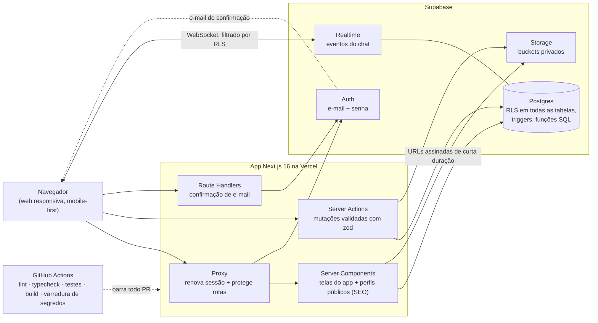
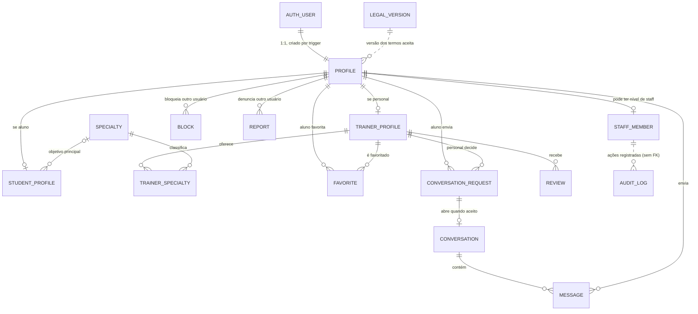

# Gym Match: estudo de caso

> **Gym Match** (nome provisório) é um marketplace de dois lados
> que conecta alunos de academia a personal trainers no Brasil.
> O código-fonte é privado. Este repositório documenta o produto, a
> arquitetura e as decisões de engenharia por trás dele.

🇺🇸 [Read in English](README.md) · 🧭 [Arquitetura em detalhe (em inglês)](docs/architecture.md)

---

## 1. Visão geral

Quem procura um personal trainer costuma encontrar um por indicação na
academia ou pelo Instagram. Nenhum dos dois caminhos permite comparar
profissionais pelo que realmente pesa na escolha: especialidade, faixa de
preço, localização, onde o treino acontece (estúdio, ao ar livre, em domicílio,
online), idiomas e as faixas etárias que o personal atende. Do outro lado, o
personal tem o problema oposto: conseguir alunos ainda depende principalmente
de prospecção no salão da academia ou nas redes sociais.

O produto tem dois tipos de usuário. O **aluno** quer um personal que combine
com seus objetivos, orçamento, localização e estilo de treino. O **personal**
quer contatos qualificados. O papel é escolhido no cadastro, e o banco de dados
impede que alguém o troque depois.

O aluno preenche um perfil curto e busca personais num **diretório com 8
filtros combináveis**. Ele pode favoritar e enviar um **pedido de conversa**. O
personal aceita o pedido numa caixa de entrada, e um **chat em tempo real** se
abre. Todo personal com perfil completo também ganha uma página pública que os
buscadores conseguem indexar. Bloqueio e denúncia funcionam nos dois sentidos,
e um **painel interno** cuida de moderação, suporte somente leitura e
auditoria.

> **A primeira decisão de produto foi abandonar o swipe.** O conceito original
> era estilo Tinder (deslizar → match). No dia 2, o modelo central mudou para
> um diretório com filtros mais _pedido → aceite_ (dois registros de decisão,
> ADR-004 e ADR-005). Um baralho de swipe às cegas esconde os atributos que de
> fato decidem a escolha, como preço, localização e especialidade. E uma caixa
> de pedidos é um funil de leads que o personal já entende, então ele nunca
> precisa sair procurando alunos.

## 2. Meu papel

Sou o **único desenvolvedor** do projeto, e este é meu primeiro produto
completo, construído de ponta a ponta. O conceito original do produto veio de
um sócio de negócios não técnico. Minhas responsabilidades:

- **Escopo do produto:** transformei o conceito numa v1 com escopo fechado,
  escrevi o charter e decidi o que ficaria de fora (pagamento de aulas pela
  plataforma, agendamento e apps nativos ficam fora da v1).
- **Arquitetura e decisões:** stack, modelo de conexão, modelo de descoberta e
  estratégia web primeiro, cada uma registrada como ADR (registro de decisão de
  arquitetura) com contexto, decisão e consequências.
- **Modelo de dados e de segurança:** schema, políticas de Row Level Security
  (RLS), permissões por coluna e a separação entre papel de produto e nível de
  staff.
- **Revisão e verificação:** revisei cada mudança. Exigi que cada uma fosse
  verificada contra o banco real, chamando a API como usuários de teste
  comuns, e testei as funcionalidades à mão a partir de roteiros escritos.
- **Operação:** configuração de GitHub, CI, Supabase e Vercel, releases e tags.

**Desenvolvimento assistido por IA, dito abertamente.** Construí o projeto com
o Claude Code como par de programação, e a maioria dos commits é coassinada por
ele. A velocidade veio daí. Meu trabalho foi manter essa velocidade segura:

- Cada sessão começava com um objetivo escrito e critérios de aceite.
- Um arquivo de regras do projeto definia os padrões de segurança.
- Um hook de pre-commit bloqueia o commit até lint, typecheck e testes
  passarem.
- Outro hook bloqueia o acesso a arquivos de segredos.
- Dois **agentes revisores somente leitura**, um de segurança e um de código,
  auditaram cada fase antes do merge.

Tratei a saída da IA como não confiável até ser verificada. Foi por isso que
os problemas da [seção 7](#7-problemas-difíceis-e-como-foram-resolvidos) foram
pegos antes de irem para o ar.

## 3. Arquitetura

Um **monólito modular**: uma única aplicação Next.js publicada na Vercel, com o
Supabase como toda a plataforma de backend. O código é organizado por
funcionalidade (`auth`, `profiles`, `discovery`, `matching`, `chat`, `admin`,
`legal`), e o código compartilhado fica separado.



Três fatos moldam esse desenho:

- **Toda consulta roda como o usuário logado.** O servidor usa a sessão do
  usuário, então o RLS do Postgres vale para toda leitura e escrita. A chave
  `service_role`, que ignora o RLS, **não é usada pelo código da aplicação**.
  Só ferramentas locais a usam (seed de fotos e testes ponta a ponta).
- **O navegador fala direto com o Supabase em um único lugar:** o chat. Ali ele
  assina novas mensagens e recibos de leitura via Realtime, e ressincroniza o
  que perdeu depois de uma reconexão. Os dois caminhos são filtrados por RLS.
- **Alguns componentes ainda não existem, e o diagrama os deixa de fora de
  propósito.** Não há app mobile nativo (decisão: web primeiro), nem
  processamento de pagamentos, nem mapas ou geolocalização
  (cidade e UF são campos de texto estruturados), nem provedor de e-mail
  externo, nem rastreamento de erros. O login com Google está implementado,
  mas desligado por uma feature flag.

Os diagramas de sequência dos fluxos principais estão em
[docs/architecture.md](docs/architecture.md).

## 4. Stack

| Camada         | Escolha                                                   | Por quê                                                                                                                                | Trade-off                                                                                                                    |
| -------------- | --------------------------------------------------------- | -------------------------------------------------------------------------------------------------------------------------------------- | ---------------------------------------------------------------------------------------------------------------------------- |
| Framework      | Next.js 16 (App Router), React 19, TypeScript (strict)    | Perfis públicos renderizados no servidor para SEO, mais server actions e rotas de auth, tudo numa única unidade de deploy              | É um framework que muda rápido: a v16 renomeou `middleware` para `proxy` com o projeto em andamento                          |
| Backend        | Supabase (Postgres, Auth, Storage, Realtime)              | Uma plataforma gerenciada cobre banco, autenticação, arquivos e websockets. Isso cabe para um dev solo com prazo e orçamento curto      | Acoplamento ao fornecedor, aceito de propósito e registrado no ADR-001                                                       |
| Autorização    | RLS do Postgres + permissões por coluna + funções SQL     | O banco aplica as regras mesmo quando alguém chama a API direto e pula a interface                                                     | Políticas são mais difíceis de depurar ([ver problema 2](#problema-2-recursão-infinita-entre-políticas-rls)) e testes unitários não as cobrem |
| Validação      | zod 4                                                     | Os mesmos schemas validam no cliente e no servidor. Toda server action valida a entrada na fronteira                                   | Algumas regras também existem como `CHECK` no banco: duas camadas de defesa, mas dois lugares para atualizar                 |
| Interface      | Tailwind CSS 4, shadcn/ui (Radix), tokens de design OKLCH | O código dos componentes fica no repositório, então um redesign completo foi trocar tokens, não reescrever telas                        | O visual padrão é genérico, então foi preciso uma rodada dedicada de redesign                                                |
| Hospedagem     | Vercel                                                    | Deploy a partir do Git, URL de preview por pull request, nenhum servidor para manter                                                   | Instâncias serverless não compartilham memória, então o rate limiter atual só protege uma instância por vez                  |
| Testes unitários | Vitest (104 testes)                                     | Testes rápidos para as regras de negócio escritas como funções puras: máquina de estados do pedido, completude do perfil, proteção de redirecionamento, permissões de staff | Não exercitam o RLS. As políticas foram verificadas contra a API real                                                        |
| Testes E2E     | Playwright (2 fluxos críticos)                            | Cobre a jornada do aluno, e aceite + chat em tempo real em dois contextos de navegador                                                 | Roda só localmente, porque o CI não tem credenciais de um banco de teste                                                     |
| CI             | GitHub Actions + gitleaks + Dependabot                    | Lint, typecheck, testes e build em todo PR, mais varredura de segredos em todo o histórico do git                                      | No plano gratuito para repositórios privados, a `main` não pode exigir checks obrigatórios                                   |
| Cliente        | Web responsiva, mobile-first (sem app nativo)             | Evita as semanas que a publicação nas lojas acrescenta e fica dentro da minha stack web (ADR-002)                                      | Sem distribuição pelas lojas e sem notificações push nativas na v1                                                           |

## 5. Modelo de dados

Visão de alto nível das principais entidades e de como se relacionam. As
colunas foram omitidas de propósito.



Regras que o próprio schema garante:

- **Um pedido ativo por par.** Um índice único parcial permite só um pedido
  aberto ou aceito por par aluno–personal. Um pedido recusado pode ser
  refeito.
- **Uma conversa só existe porque um pedido foi aceito.** O cliente não tem
  permissão de inserir conversas. Um trigger do banco abre a conversa quando o
  personal aceita.
- **Mensagens não podem ser editadas.** Um trigger rejeita qualquer alteração
  que não seja o recibo de leitura, e o próprio banco carimba esse horário,
  então o cliente não consegue falsificá-lo.
- **Avaliações são públicas, mas o autor é anônimo.** Permissões por coluna
  escondem da API o id de quem avaliou.
- **O log de auditoria só aceita inserções e não tem chave estrangeira para
  pessoas.** A identidade de quem agiu é copiada no momento da escrita, então a
  autoria sobrevive à exclusão da conta.
- **Registros de exclusão não guardam dados de perfil.** Quando uma conta é
  excluída, o registro guarda só o papel, quem pediu, quando, e um hash
  irreversível do e-mail. O hash impede que um usuário suspenso escape da
  suspensão se cadastrando de novo.

## 6. Segurança e privacidade

### Implementado

**Autenticação**

- Login com e-mail e senha pelo Supabase Auth, com confirmação de e-mail. A
  sessão fica em cookies, e o proxy do Next.js a renova a cada requisição.
- Quem protege a área logada é o servidor, não a interface. O papel do usuário
  é sempre lido do banco, nunca de metadados enviados pelo cliente.
- Uma proteção contra open redirect confere todo parâmetro `next`. Ela também
  rejeita caracteres de controle ASCII, que os navegadores removem de um jeito
  que transforma `/<TAB>/evil` em `//evil`. Uma revisão de segurança encontrou
  esse desvio.
- Erros de autenticação viram mensagens amigáveis que não revelam nada da
  implementação.

**Autorização: o banco é a fronteira**

- O RLS está ativo em **todas as tabelas (18)**, e tudo o que não é
  explicitamente permitido é negado. Visitantes anônimos só leem os dados
  públicos do diretório de personais.
- **O RLS decide quais linhas; as permissões por coluna decidem quais
  colunas.** O cliente só escreve nas colunas que são dele. Papel, selo de
  verificação e timestamps são gerenciados pelo servidor, e as colunas
  legíveis são uma lista explícita.
- Triggers garantem as transições de estado: os participantes do pedido não
  mudam, o horário da decisão é carimbado pelo banco e a conversa só abre pelo
  aceite.
- O bloqueio é aplicado no RLS **nos dois sentidos**. Um par bloqueado não
  troca mensagens nem abre pedido novo.
- Funções auxiliares que precisam de privilégio elevado (`SECURITY DEFINER`)
  fixam o `search_path`, respondem **só sobre quem chama** e não podem ser
  executadas por anônimos. Assim, não servem para sondar dados de outros
  usuários.
- A busca do diretório roda com os privilégios de quem chama, então só enxerga
  o que as políticas já tornam público.

**Arquivos**

- Somente buckets privados, com limite de tamanho e de tipo de arquivo
  definido no próprio bucket.
- O servidor gera os nomes dos arquivos, e cada usuário só escreve na própria
  pasta.
- A leitura é feita por URLs assinadas que expiram em 1 hora.
- Fotos de aluno nunca são públicas. Um trigger fixa o formato do caminho do
  avatar, para ninguém conseguir apontá-lo para o arquivo de outra pessoa.

**Painel de staff**

- O poder de staff é **independente do papel de produto**, com três níveis
  (suporte < admin < owner). Transformar "admin" num papel de produto teria
  quebrado todas as políticas existentes.
- O painel responde **404** para quem não é staff, o que não revela que ele
  existe.
- Toda ação privilegiada é uma única função no banco. Ela confere o nível,
  exige uma justificativa escrita e grava a mudança e a linha de auditoria **na
  mesma transação**. Uma ação sem registro é, portanto, impossível.
- **O modo suporte é somente leitura.** Não existe "entrar como o usuário". Ler
  o conteúdo das mensagens exige uma ação explícita de "quebrar o sigilo", com
  justificativa, e a linha de auditoria é gravada *antes* de o conteúdo ser
  devolvido.
- Os dashboards devolvem só agregados, nunca linhas. Uma página de "raio-x de
  permissões" lê a matriz de RLS ao vivo, direto do catálogo do Postgres.

**Dados pessoais (LGPD)**: implementado numa branch de funcionalidade, ver o
[status](#8-status-atual)

- O cadastro exige consentimento explícito (maior de 18 anos, termos),
  validado no servidor. A versão aceita dos termos precisa existir numa lista
  mantida pelo servidor, e o consentimento também é uma **condição do RLS** para
  enviar pedidos e mensagens.
- O próprio usuário pode exportar seus dados e excluir sua conta. As fotos são
  removidas primeiro pela API do Storage, e só depois a conta é excluída.
- IP e user-agent no log de auditoria são dados pessoais. Uma função de
  retenção os remove depois de 90 dias e mantém os fatos auditados. O
  agendamento dessa função ainda está pendente.

**Segredos e cadeia de dependências**

- Segredos vêm só de variáveis de ambiente, e um arquivo modelo lista os
  placeholders.
- O gitleaks roda como hook de pre-commit e no CI, sobre todo o histórico.
- O Dependabot abre atualizações toda semana, e o token do CI é somente
  leitura.

**Pagamentos:** o código não processa pagamentos, então não há webhooks de
pagamento a proteger.

**Processo:** uma revisão de segurança dedicada rodou em cada fase. Duas
voltaram **FAIL** (o painel de staff e a primeira versão dos fluxos de LGPD).
Todos os achados de alta gravidade foram corrigidos e verificados de novo antes
do merge.

### Planejado / lacunas conhecidas

- Rate limiting de nível de produção, na borda ou no banco. Hoje o limitador
  roda em memória em cada instância serverless, e chamadas diretas à API passam
  por fora dele.
- Um provedor de SMTP próprio, obrigatório antes de qualquer usuário real se
  cadastrar.
- Checar o conteúdo dos uploads pela assinatura do arquivo (magic bytes), e não
  só pelo tipo MIME.
- Testes automatizados de RLS no CI, contra um banco local.
- Rastreamento de erros.

## 7. Problemas difíceis e como foram resolvidos

### Problema 1: "E-mail confirmado, mas o usuário não está logado"

**Sintoma.** Clicar no link de confirmação confirmava a conta, mas o usuário
chegava sem sessão e não via nenhum erro.

**Causa raiz (reproduzida antes).** Eram duas causas:

- O modelo padrão de e-mail usava o fluxo _implícito_. Os tokens chegavam no
  fragmento da URL (`#…`), e o navegador nunca envia o fragmento ao servidor.
- A lista de URLs de redirecionamento permitidas estava descartando a rota de
  confirmação.

**Correção: três camadas.**

1. Uma rota de confirmação no servidor trata os formatos de token que o
   servidor consegue ler.
2. Um pequeno componente no cliente pega os tokens do fragmento e os envia por
   POST a um route handler. O handler faz o servidor de autenticação
   validá-los antes de criar a sessão em cookie, então tokens inválidos ou
   expirados nunca geram sessão.
3. Os erros de autenticação viraram mensagens visíveis, com a opção "reenviar
   confirmação".

Depois, a configuração do painel do Supabase (lista de redirecionamentos e
modelo de e-mail) foi corrigida.

```ts
// Padrão genérico: nunca confiar em tokens do fragmento; o servidor de auth valida.
const parsed = tokenSchema.safeParse(Object.fromEntries(await request.formData()));
if (!parsed.success) return failure;
const { error } = await supabase.auth.setSession(parsed.data); // validado no servidor
if (error) return failure;
```

**Resultado.** Verificado ponta a ponta num build de produção local (link
direto, caminho de resgate, link expirado), e depois confirmado em produção
com uma conta real em 12/07/2026.

### Problema 2: Recursão infinita entre políticas RLS

**Sintoma.** Aconteceu duas vezes:

- **Uploads:** todo upload de arquivo do projeto falhava com 503, não só os da
  galeria.
- **Pedidos:** criar um pedido de conversa falhava em produção. O bug existia
  desde o primeiro schema e só apareceu quando a API real foi testada como um
  aluno de verdade.

**Causa raiz.** Erro `42P17` do Postgres: as políticas se compõem.

- A política de upload da galeria contava as fotos existentes consultando a
  mesma tabela de storage que ela protegia.
- A política de pedidos conferia o papel de quem chamava lendo `profiles`. Uma
  política de `profiles`, por sua vez, lê os pedidos de conversa, o que fechava
  o ciclo.

**Correção.** As duas consultas foram para pequenas funções `SECURITY DEFINER`.
Elas ignoram o RLS, então o ciclo some, e respondem só sobre quem chama, então
não vazam nada:

```sql
create function public.is_student(uid uuid) returns boolean
language sql stable security definer set search_path = '' as $$
  select uid = (select auth.uid())            -- responde só sobre quem chama
     and exists (select 1 from public.profiles
                 where id = uid and role = 'student');
$$;
```

**Lição.** Uma política que lê outra tabela herda as políticas dessa tabela.
Testar como dono do banco esconde esses bugs, então eu testo pela API real,
com papéis reais.

### Problema 3: Uma revisão de segurança que voltou FAIL

Durante a construção do painel de staff (gestão de usuários, moderação, modo
suporte), a revisão encontrou duas falhas de **alta gravidade** antes do
lançamento:

1. **Uma nota interna ficou pública.** A suspensão acrescentou colunas novas em
   `profiles`. Essa tabela tinha uma política pública de leitura para as linhas
   de personal e permissões no nível da tabela, então a nota interna de
   suspensão entrou em silêncio na API pública, e **usuários anônimos**
   conseguiam lê-la.
2. **A suspensão não suspendia.** Ela só era aplicada em dois caminhos de
   escrita. Um personal suspenso ainda aceitava alunos, editava o perfil,
   enviava fotos e mantinha a página pública no ar.

Uma falha de gravidade média também apareceu. Uma função marcada como `STABLE`
gravava linhas de auditoria, e a API roda funções estáveis em transação
somente leitura, então o modo suporte nunca teria funcionado.

**Correção.**

- `profiles` passou a ter permissões de leitura por coluna: uma lista explícita,
  então colunas novas nascem privadas.
- A suspensão agora é aplicada no banco em todos os caminhos de escrita
  (pedidos, aceite, edição de perfil, favoritos, uploads, página pública).
- As funções administrativas devolvem colunas explícitas em vez de serializar a
  linha inteira.

**Resultado.** Verificado contra o banco real:

- Uma leitura anônima da nota recebe **permission denied**.
- Um personal suspenso some do diretório e é bloqueado ao tentar escrever.
- Reativar a conta restaura tudo.

## 8. Status atual

**O projeto está pausado**. Tudo abaixo existe no repositório.
Os dois últimos blocos estão completos em branches de funcionalidade, mas
**não foram mergeados** na `main` (que é o que está publicado).

**Linha do tempo**

| Data              | Marco                                                                                                          |
| ----------------- | -------------------------------------------------------------------------------------------------------------- |
| 07/07/2026        | Início: charter, registros de decisão, fluxo de trabalho                                                       |
| 08/07/2026        | **v0.1.0**: estrutura inicial, CI, schema + RLS, autenticação, primeiro deploy em produção                     |
| 08/07 → 12/07     | **v0.2.0**: onboarding, fotos, diretório + favoritos, pedido → aceite → chat em tempo real, páginas públicas, E2E |
| 13/07/2026        | **v0.3.0**: painel de staff (dashboards, usuários, moderação, modo suporte, auditoria, retenção de dados)      |
| 14/07 → 05/08     | Conformidade com a LGPD: consentimento, exportação, exclusão (duas rodadas de revisão de segurança), numa branch |
| 05/08 → 06/08     | Redesign completo da interface e design system, numa branch                                                    |
| 28/08/2026        | Proteções no fluxo com IA: regras por caminho, hook de pre-commit com a Definition of Done                     |
| 15/10/2026        | Base de segurança: gitleaks (hook + CI), Dependabot, política de segurança                                     |

**Publicado (`main`, v0.3.0)**

- [x] Autenticação por e-mail + senha com confirmação; app que muda conforme o papel
- [x] Dois fluxos de onboarding; o personal só aparece no diretório com perfil 100% completo
- [x] Foto de perfil e galeria do personal em storage privado
- [x] Diretório com filtros (8 filtros, URLs compartilháveis, paginação) e favoritos
- [x] Pedido → aceite → chat em tempo real (envio otimista, recibo de leitura, ressincronização após reconexão)
- [x] Bloqueio e denúncia
- [x] Páginas públicas de personal para SEO, com avaliações anônimas
- [x] Painel de staff com log de auditoria que só aceita inserções
- [x] Gates de qualidade no CI em todo pull request

**Construído em branches de funcionalidade, não mergeado**

- [x] LGPD: páginas de termos e privacidade, consentimento no cadastro, exportação de dados, exclusão de conta
- [x] Design system e redesign completo da interface (escuro por padrão, skip links, suporte a movimento reduzido)
- [x] Base de segurança (varredura de segredos, Dependabot)

**Ainda não construído**

- [ ] Envio de e-mail próprio (SMTP)
- [ ] Rate limiting de nível de produção
- [ ] Criação de avaliações (hoje são só exibidas, com dados de seed)
- [ ] Ativar o login com Google
- [ ] App mobile nativo (a ser reavaliado depois da v1)
- [ ] Busca por raio de distância
- [ ] Rastreamento de erros, beta com usuários reais, v1.0

**Números:** 24 migrations · 18 tabelas, todas com RLS · 104 testes unitários
· 2 fluxos E2E · 16 pull requests mergeados.

## 9. O que aprendi / o que faria diferente

**O que aprendi**

1. **O banco é a fronteira de segurança; a interface é só UX.** Toda regra que
   importa (quem fala com quem, bloqueio, suspensão, consentimento) vive no RLS
   e nos triggers, e a interface só a espelha. Vários bugs reais só apareceram
   quando chamei a API direto, como um usuário comum.
2. **Lista de permissões por padrão.** Acrescentar uma coluna já tornou pública
   uma nota interna. Com permissões por coluna, "privado" é o padrão e
   "público" é uma decisão.
3. **Registrar as decisões por escrito.** Os registros de decisão me deixaram
   mudar o modelo central (swipe → pedido/aceite) no dia 2, com o raciocínio
   preservado para quem ler o código depois, inclusive eu.
4. **Reproduzir antes de corrigir.** O bug do e-mail tinha várias causas
   plausíveis. Reproduzir primeiro apontou a verdadeira e evitou reescrever
   código que funcionava.
5. **A IA deixa você mais rápido; a verificação continua sendo trabalho meu.**
   Critérios de aceite escritos, revisores independentes e verificação no
   ambiente real pegaram dois vereditos FAIL de segurança antes de irem para o
   ar. Velocidade sem esse ciclo teria publicado os dois.

**O que eu faria diferente**

1. **Rodar um Supabase local e testes automatizados de políticas no CI desde o
   primeiro dia.** As migrations foram aplicadas pelo painel, e o RLS foi
   verificado à mão.
2. **Tratar o envio de e-mail como infraestrutura do dia 1.** O serviço de
   envio embutido foi a maior fonte de atrito.
3. **Fazer merges menores e mais cedo.** Dois blocos de trabalho prontos
   ficaram em branches longas quando o projeto pausou.
4. **Ter rate limiting compartilhado antes do primeiro endpoint público.** Em
   serverless, limite em memória é quase simbólico.
5. **Montar o design system antes de construir as telas, não depois.**

## 10. Capturas de tela

> Todas as capturas usam **dados fictícios**.

| Tela                                   | Imagem                   |
| -------------------------------------- | ------------------------ |
| Landing page                           | _placeholder_            |
| Diretório com filtros (aluno)          | _placeholder_            |
| Perfil público do personal             | _placeholder_            |
| Caixa de pedidos (personal)            | _placeholder_            |
| Chat em tempo real (duas janelas)      | _placeholder_            |
| Onboarding com completude              | _placeholder_            |
| Dashboard de staff (só agregados)      | _placeholder_            |
| Linha do tempo da auditoria            | _placeholder_            |
| Raio-x de permissões                   | _placeholder_            |

<!-- Arquivos sugeridos: docs/screenshots/01-landing.png … 09-permissions.png -->

---

_O código-fonte é privado porque o projeto tem um sócio. Fico à
disposição para apresentá-lo numa entrevista._
