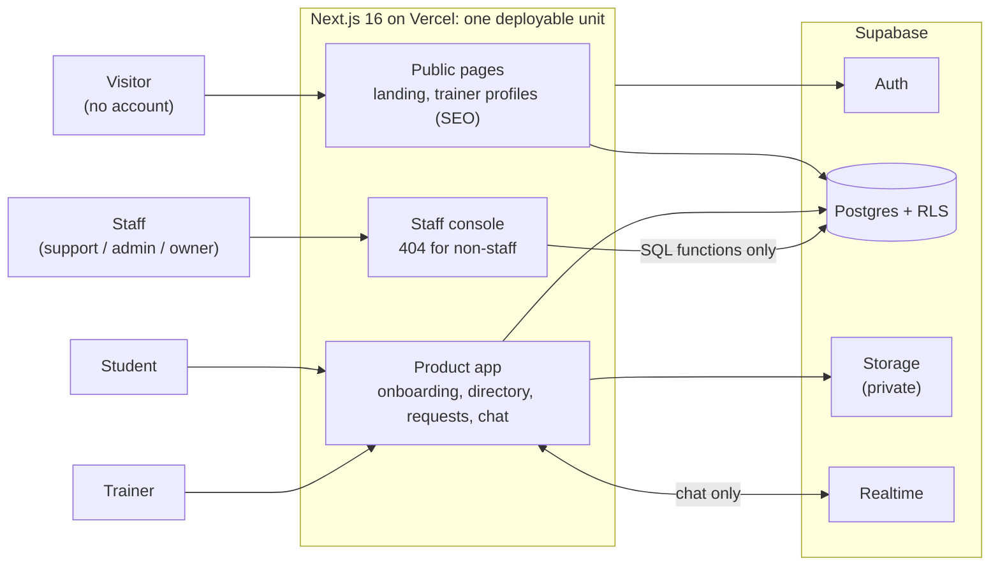
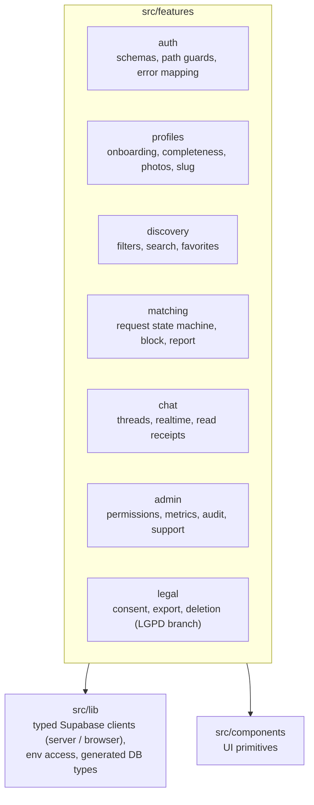
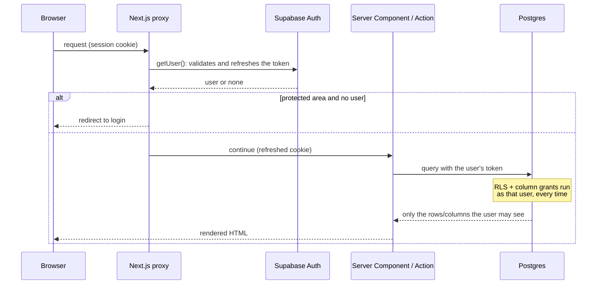
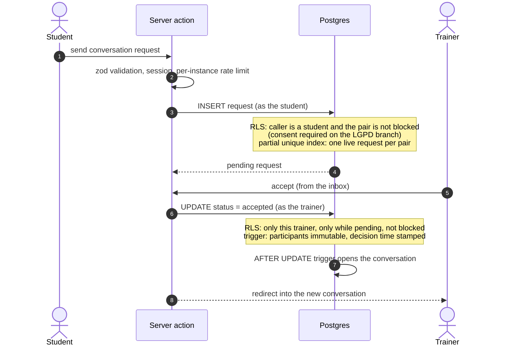
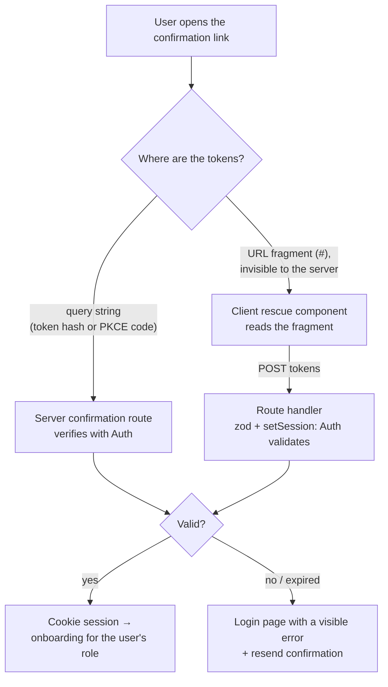
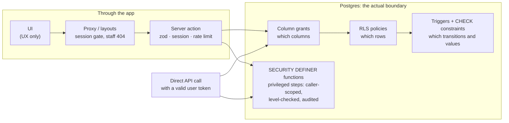
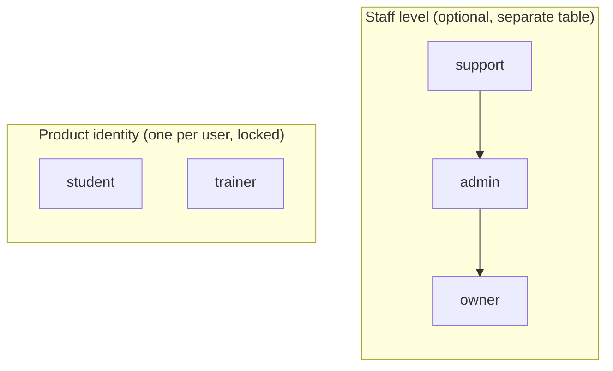
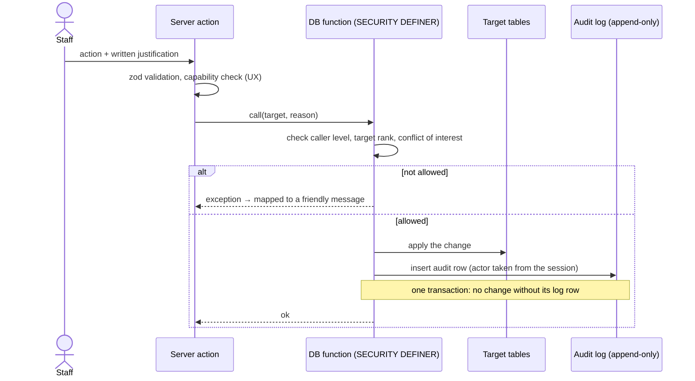
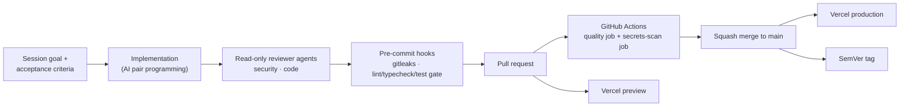

# Architecture deep dive

This page adds detail to the [README](../README.md). It covers how a request
moves through the system, how the main flows work, and where security is
enforced. Everything here describes code that exists. Items that do not exist
yet are labeled as such.

## 1. System context



**Not in the system today:**

- native mobile apps (web first, ADR-002)
- payment processing
- maps or geolocation (city and state are structured text; a radius search
  would be an additive migration)
- an external e-mail provider (the built-in sender is used)
- error tracking

Google sign-in is implemented behind a feature flag and switched off.

## 2. Code organization

Feature-first modules. Each feature owns its server actions, queries,
validation schemas, components and tests.



The rules a feature depends on are written as **pure functions with unit
tests**: which request decisions are valid, what the call-to-action shows,
profile completeness, safe redirect paths and staff capabilities. The
database enforces the same rules independently.

## 3. Lifecycle of a page request



There is no "trusted server" shortcut. The server talks to Postgres with the
user's own token, never with the `service_role` key, so a bug in a page can't
show data the policies would deny.

## 4. Connection flow: request → accept → conversation



Clients have **no insert permission on conversations**. The only way a
conversation can exist is through an accepted request.

## 5. Realtime chat

```mermaid
sequenceDiagram
    participant A as Sender's browser
    participant SA as Server action
    participant DB as Postgres
    participant RT as Supabase Realtime
    participant B as Recipient's browser

    A->>A: show the message optimistically ("sending…")
    A->>SA: send message
    SA->>DB: INSERT as the sender (RLS: participant, pair not blocked)
    DB-->>SA: stored row
    SA-->>A: swap the optimistic row for the stored one (or mark it failed)
    DB-)RT: INSERT event
    RT-)B: event, delivered only if RLS lets B read the row
    B->>SA: mark conversation as read
    SA->>DB: UPDATE read_at (trigger stamps the time; write-once)
    DB-)RT: UPDATE event
    RT-)A: read receipt
    Note over A,B: every (re)subscription refetches messages newer than the<br/>last confirmed one, so nothing is lost while offline
```

## 6. E-mail confirmation with a rescue path



The rescue component is mounted on the confirmation page and on the landing
page, because that is where a misconfigured redirect drops users. Background
is in [README › Problem 1](../README.md#problem-1-e-mail-confirmed-but-the-user-is-not-logged-in).

## 7. Where security is enforced



Anyone holding a valid token can skip the left-hand side entirely by calling
the API directly. So every rule that matters lives on the right, and the
app-side checks exist for user experience and for early, friendly errors.
Policies were verified this way, with direct API calls as ordinary test users,
not only through the UI.

Conventions for the privileged functions:

- `search_path` is pinned to an empty string, and all names are fully
  qualified.
- They answer **only about the caller**, for example "am I a student?" or "is
  my pair blocked?". They never answer about arbitrary users, so they can't
  be used as an oracle.
- `EXECUTE` is revoked from anonymous users and granted only where a policy
  needs it.
- Functions that write audit rows are not marked `STABLE`. The API runs
  stable functions in a read-only transaction, and an audited read must be
  able to write.

## 8. Staff model



A staff member keeps a normal product account. The founder, for instance, is
a student in the product and the owner in the console. Keeping the two
dimensions separate meant none of the product's RLS policies had to change
when the console was added.

| Capability                                             | support | admin | owner |
| ------------------------------------------------------ | :-----: | :---: | :---: |
| Dashboards (aggregates only)                           |   ✅    |  ✅   |  ✅   |
| Search users, view a user's file                       |   ✅    |  ✅   |  ✅   |
| Moderation queue                                       |   ✅    |  ✅   |  ✅   |
| Read-only support view (metadata, no message content)  |   ✅    |  ✅   |  ✅   |
| Verify a trainer, suspend / reactivate                 |   ❌    |  ✅   |  ✅   |
| Read message content ("break the seal", justified)     |   ❌    |  ✅   |  ✅   |
| Full audit timeline                                    |   ❌    |  ✅   |  ✅   |
| Manage staff                                           |   ❌    |  ❌   |  ✅   |

Every privileged action follows the same shape:



Further guardrails:

- No one can act on someone of equal or higher rank.
- No one can change their own level.
- No one can decide a report that involves them.
- The audit log has no update or delete path from the app.

Retention: a function removes IP address and user-agent from audit rows older
than 90 days and keeps the facts. Scheduling it is still pending.

## 9. Account deletion order (LGPD branch)

```mermaid
sequenceDiagram
    actor U as User or admin
    participant SA as Server action
    participant DB as Postgres
    participant ST as Storage API

    U->>SA: delete account (typed confirmation / admin justification)
    SA->>DB: authorize first (admins: level, reason, never self, never staff; audited)
    SA->>ST: remove every photo (paginated, recursive)
    Note right of ST: Postgres refuses direct deletes of storage rows,<br/>so files must go through the Storage API
    SA->>DB: delete the account
    Note over DB: cascades to profile, requests, conversations, messages<br/>deletion record keeps no profile data (only an e-mail hash)
```

The order matters. An earlier version purged photos *before* the database
checked whether the deletion was allowed. Pointing the form at a protected
account could therefore destroy that account's photos without leaving a log
entry. A security review caught it, and authorization now always comes first.

## 10. Delivery pipeline



- Commits follow Conventional Commits, and releases are tagged with SemVer
  (v0.1.0 → v0.3.0).
- Both pre-commit hooks were added later: the Definition-of-Done gate in
  August 2026 and gitleaks in October 2026.
- Database migrations are versioned SQL files in the repository. They were
  applied through the platform tooling rather than a local CLI, which is one
  of the things I would change ([README › section 9](../README.md#9-what-i-learned--what-i-would-do-differently)).

## 11. Decision records (summary)

| ADR | Decision                                                                 | Main consequence                                                                         |
| --- | ------------------------------------------------------------------------ | ---------------------------------------------------------------------------------------- |
| 001 | Next.js + TypeScript on Vercel; Supabase as the whole backend platform   | One deployable unit and minimal ops; vendor coupling accepted                            |
| 002 | Mobile-first responsive web; native app re-evaluated after v1            | No app-store review cycles; no native push in v1                                         |
| 004 | Connection model: student requests → trainer accepts (not mutual swipe)  | The data model centers on requests + favorites; trainers get a lead inbox                |
| 005 | Discovery: filtered directory; city/state as structured fields, no PostGIS | Indexed, filterable trainer attributes (arrays + GIN, join table); geo search deferred  |
